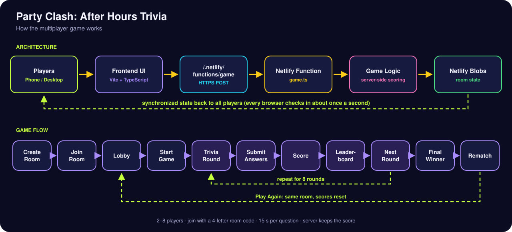
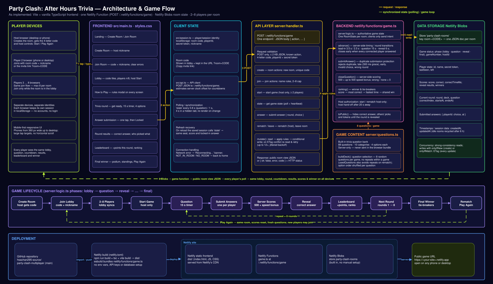

# Party Clash: After Hours Trivia

**▶ Play now: https://phenomenal-kelpie-848538.netlify.app/**

A real-time multiplayer trivia game show for **2–8 players** on their own phones or computers. One player creates a room and shares a 4-letter code. Everyone answers the same question against the same clock, and the fastest correct answers win.

Built with TypeScript + Vite on the front end, a single **Netlify Function** on the back end, and **Netlify Blobs** for room state. It needs no database, API keys, environment variables or paid services.

---

## Live Demo

🎮 **https://phenomenal-kelpie-848538.netlify.app/**

Open the link on any phone or computer. One player taps **Create Room** and shares the 4-letter room code. **2–8 players** can then join remotely from their own devices by entering that code. No app or account is needed.

---

## Rules

1. **Join.** The host taps **Create Room** and gets a 4-letter code (no look-alike letters such as I/O). Other players tap **Join Room** and enter the code and a nickname, or open the host's invite link. Rooms hold 2–8 players.
2. **Start.** Only the host can start, and only once at least 2 players are in.
3. **Answer fast.** Each of the **8 rounds** shows everyone the same multiple-choice question. You have **15 seconds** to tap one of 4 answers. You get one answer per question and can't change it once it's locked in.
4. **Score.** A correct answer earns **500 points plus a speed bonus of up to 500**, scaled by the time left. A wrong answer or no answer earns 0. The server calculates every score.
5. **Reveal.** When everyone has answered, or the timer runs out, all players see the correct answer, who picked what, and the leaderboard. The next round starts automatically.
6. **Win.** After round 8 the highest score wins. Ties are broken by **most correct answers**, then by **lowest total answer time on correct answers**. If players are still tied, they **share the win**.
7. **Rematch.** On the final screen the host taps **Play Again**. Everyone returns to the same lobby with scores reset and fresh questions. New players can join at that point.

The rules are also available in the game through the **How to play** / **?** button on every screen.

---

## Run locally

Requires Node.js 20+ (22 recommended).

```bash
npm install
npm run dev
```

Open the printed URL, for example `http://localhost:5173`. To play from your phone on the same Wi-Fi, use the **Network** URL that Vite prints.

> **Testing several players on one computer:** each browser profile stores one player identity, so use different browsers, a private window, or different hostnames (`localhost`, `127.0.0.1`, or your LAN IP) for each player.

In `npm run dev`, Vite serves `/.netlify/functions/game` from the **same handler code** as the production function. It uses an in-memory store with the same compare-and-swap rules, so you don't need a Netlify account.

### Scripts

| Command | What it does |
|---|---|
| `npm run dev` | Local dev server, front end plus game API |
| `npm run build` | Type-check (`tsc`) and production build into `dist/` |
| `npm test` | Multiplayer API test suite: full games, scoring, ties, concurrency, security |
| `npm run test:blobs` | The same suite through the real `@netlify/blobs` client and Netlify's local Blobs emulator |
| `npm run test:e2e` | Browser end-to-end game with 3 independent players (desktop and phones). Needs a running server and Google Chrome |
| `node tests/e2e/stress.mjs <url>` | 8-client concurrency stress test against a running server |

---

## Architecture



**How a move travels:** Players on phone/desktop → Frontend UI → `/.netlify/functions/game` → Netlify Function → Game Logic / server-side scoring → Netlify Blobs → synchronized state back to all players.

**Game flow:** Create Room → Join Room → Lobby → Start Game → Trivia Round → Submit Answers → Score → Leaderboard → Next Round (×8) → Final Winner → Rematch.

<details>
<summary>Detailed technical diagram</summary>



Editable source: [`docs/party-clash-architecture.drawio`](docs/party-clash-architecture.drawio). Open it in [draw.io](https://app.diagrams.net).

</details>

**Frontend.** A single-page app in vanilla TypeScript, built with Vite (`src/main.ts`, `src/styles.css`). It has no framework. Each screen is a render function: landing, create, join, lobby, how-to-play, question, results with leaderboard, and final winner with rematch. The page re-renders only when the room state changes. A 100 ms tick updates timers in place, and the layout is mobile-first from 360 px phones up to desktop.

**Multiplayer synchronization.** Every browser polls the `state` action about once a second (every 0.8 s during a question, every 4 s in a background tab). Each poll returns the same public view of the room, so all players see the same lobby, round, countdown, results, leaderboard and winner. Clients estimate their offset from the server clock (`src/api.ts`) so countdowns match across devices.

**Netlify Function API.** There is one endpoint, `POST /.netlify/functions/game` (`netlify/functions/game.ts` → `server/handler.ts`), with the actions `create`, `join`, `state`, `start`, `answer`, `rematch` and `leave`. The handler validates the method, body size, JSON, action, room code and player token. It then runs a read → apply rules → conditional write loop and retries up to 12 times if another player wrote first.

**Netlify Blobs state storage.** Each room is one JSON document in the store `party-clash-rooms` under the key `room-<CODE>`. It holds game status, players (with secret tokens), scores, the current question and deadlines, submitted answers, results, winners and timestamps. Reads use strong consistency. Writes use `onlyIfNew` when a room is created and `onlyIfMatch: <ETag>` for every update, so simultaneous actions never overwrite each other.

**Server-side scoring and timing.** All rules live in `server/logic.ts`:
- Questions carry server `startsAt` / `endsAt` times: a 3.5 s lead-in for round 1 and 2.5 s after that, 15 s to answer, then a 6 s reveal.
- `advance()` closes a question when every connected player has answered or time runs out, then moves to the next round or the final screen.
- `submitAnswer()` rejects duplicate, early, late (beyond a 300 ms grace) and invalid answers.
- Scoring is 500 points + up to 500 speed bonus. Ties go to most correct answers, then fastest total time, then a shared win.
- The correct answer, other players' picks and tokens never leave the server before the reveal. The 88-question bank (`server/questions.ts`) is not in the browser bundle.

**Refresh and session recovery.** `src/session.ts` keeps `{ room code, playerId, secret token, nickname }` in `localStorage`. After a refresh the app calls `state` with the saved session and resumes the same seat, score and locked-in answer. Invite links carry `?room=CODE`. If the host is gone for 20 s, host controls pass to another connected player.

**Production deployment flow.** GitHub (`main`) → Netlify build (`netlify.toml`: `npm run build` = `tsc` + `vite build` → `dist/`; esbuild bundles `netlify/functions/game.ts`) → Netlify serves the static front end from its CDN and the function at `/.netlify/functions/game`, with Netlify Blobs built in → public URL. No environment variables, API keys or database setup are needed.

---

## Game Flow

**Create Room → Join Room → Lobby → Start → 8 Trivia Rounds → Score/Leaderboard → Winner → Rematch**

1. **Create Room.** The host enters a nickname and gets a 4-letter code with no look-alike letters, plus an invite link.
2. **Join Room.** Players enter the code and a nickname, or open the link. Wrong codes, full rooms, games in progress and duplicate nicknames get clear errors.
3. **Lobby.** All devices show the player list (n/8) live. The host's **Start Game** button unlocks once at least 2 players are in. Everyone else sees "Waiting for host…".
4. **Start.** The host starts, and the server picks 8 random, non-repeating questions and schedules round 1.
5. **8 Trivia Rounds.** Each round: everyone sees "Get ready", then the same question with a 15 s timer and 4 options. Each player taps one answer, which locks in.
6. **Score/Leaderboard.** When all players have answered or time is up, the server scores the round. Everyone sees the correct answer, who picked what, the points earned and the updated leaderboard. The next round starts automatically after 6 s.
7. **Winner.** After round 8 the final screen shows the champion or co-champions, a podium and the final standings.
8. **Rematch.** The host taps **Play Again** and everyone returns to the same lobby with scores reset and new questions. Players can leave, and new players can join.

---

## Project Structure

```
├── index.html                       # App shell (mounts #app)
├── public/favicon.svg               # Site icon
├── src/                             # FRONTEND (browser)
│   ├── main.ts                      # All screens, rendering, polling loop, input handling, refresh resume
│   ├── api.ts                       # POST client for /.netlify/functions/game and server-clock sync
│   ├── session.ts                   # Player/session identity in localStorage
│   └── styles.css                   # Late-night game-show theme, responsive and mobile-first
├── shared/
│   └── types.ts                     # Public API types and game constants (players, rounds, timers, points)
├── server/                          # BACKEND helpers (bundled into the function)
│   ├── handler.ts                   # Request validation, action routing, read→apply→conditional-write retry loop
│   ├── logic.ts                     # Authoritative rules: rooms, joining, timing, answers, scoring, winners, host, rematch
│   ├── store.ts                     # Netlify Blobs room store (production), in-memory store (dev and tests)
│   └── questions.ts                 # Server-only trivia question bank (88 questions)
├── netlify/
│   └── functions/game.ts            # Netlify Function entry → /.netlify/functions/game
├── dev/local-blobs.ts               # Starts Netlify's local Blobs emulator (used by test:blobs)
├── tests/
│   ├── multiplayer.test.ts          # API test suite: full games, ties, security, concurrency
│   ├── run-blobs.ts                 # Runs the suite through @netlify/blobs and the emulator
│   └── e2e/
│       ├── browser-game.mjs         # 3-player browser end-to-end game (desktop and phones)
│       └── stress.mjs               # 8-client concurrency stress test
├── docs/
│   ├── architecture.svg                  # Simple architecture + game-flow diagram (README)
│   ├── party-clash-architecture.drawio   # Editable architecture and game-flow diagram
│   ├── party-clash-architecture.svg      # Detailed technical diagram (export of the .drawio)
│   └── generate_architecture_drawio.py   # Regenerates the .drawio from the implementation's facts
├── netlify.toml                     # Build command, publish dir, functions dir, headers
├── vite.config.ts                   # Vite build, plus a dev-server route for the game API
├── tsconfig.json                    # Strict TypeScript config
└── package.json / package-lock.json # Scripts and pinned dependencies
```

---

## Deploying to Netlify

No configuration beyond `netlify.toml` is needed:

- **Build command:** `npm run build`
- **Publish directory:** `dist`
- **Functions directory:** `netlify/functions` (bundled with esbuild)
- **Environment variables:** none
- **Database:** none. Netlify Blobs is available to every Netlify site automatically.

**Recommended: deploy from GitHub.** In Netlify choose **Add new site → Import an existing project → GitHub**, then pick this repository. The settings are read from `netlify.toml`. Click **Deploy**.

**Alternative: Netlify CLI.** Run `npx netlify-cli deploy --build --prod` from the project folder.

> Netlify Drop (drag-and-drop) publishes static files only and does **not** build or run Netlify Functions. Use the GitHub import or the CLI so the multiplayer back end is deployed.

---

## Testing notes

- `npm test` plays complete 8-round games against the real handler and checks: sync, scoring maths, duplicate, late and early answers, tie-breakers, shared wins, rematch, refresh recovery, host hand-off, forged tokens, correct-answer secrecy, the 8-player cap and concurrent writes.
- Netlify's *local* Blobs emulator doesn't return ETags on reads, so conditional writes can't be fully exercised locally. That's why the dev server and the default test suite use an in-memory store with strict compare-and-swap. Production Netlify Blobs returns ETags and enforces `onlyIfMatch`.
